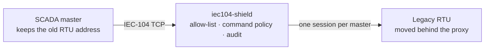

# IEC 104 Shield

An **IEC 60870-5-104 security proxy** for legacy RTUs, gateways and
substations. One static Go binary. The master keeps its configuration; the
RTU keeps speaking plain IEC-104; the proxy does the command policy, audit and
fail-closed takeover.

**Status:** v0.1 software prototype. The independent-peer loopback proof and
master-facing IEC 62351-3 TLS pass. Physical RTU validation, IEC 62351-5
authentication, conformance testing and real IP takeover are still open. Do
not treat this as a certified utility product yet.



## Why

IEC-104 is the European utility telecontrol protocol. It carries measurements
and status, but also **commands**: breaker operations, setpoints, clock sync,
reset and parameter changes. The base protocol has no authentication or
encryption. IEC 62351-3/5 exist, but deployment is uneven.

A port-based firewall can allow TCP 2404; it cannot tell a read from a trip.
This proxy parses the IEC-104 application layer and decides whether a command
may cross.

## What it does

- **Address takeover.** The proxy owns the RTU's old `IP:port`. The RTU is
  re-patched and gets a new address. The master does not change.
- **Command policy.** Scope by ASDU type, common address, information-object
  address and select/execute. Deny-overrides; default deny.
- **Correct refusal.** A denied command gets a negative activation
  confirmation (COT 7 + P/N) and never reaches the RTU.
- **Independent sequence spaces.** The proxy is a terminating proxy, not a
  byte relay. It acknowledges each leg and allocates fresh N(S)/N(R), so a
  denied I-frame cannot desynchronise the master and the RTU.
- **Fail-closed.** If the proxy or the upstream path stops, the old address is
  gone. The RTU is not silently exposed.
- **Read-only mode.** Block every write-class ASDU; keep interrogation,
  counter interrogation, read and test commands.
- **Audit and metrics.** JSON-lines security decisions, including allowed and
  denied control commands, plus Prometheus metrics.
- **Unknown types fail closed.** Master-to-RTU types the proxy cannot classify
  are refused unless `allow_unknown_types` is explicitly set. A write type
  whose information objects cannot be parsed is always refused, even with that
  flag.

## Quick start

Build:

```sh
go build -o bin/iec104-shield ./cmd/iec104-shield
```

A minimal gateway with a scoped command policy:

```yaml
# configs/gateway.yaml
devices:
  - name: substation-rtu
    listen_addr: "0.0.0.0:2404"     # the address the master already uses
    device_addr: "10.0.0.10:2404"   # the RTU's new address behind the proxy
    allow: ["10.0.0.0/24"]
    max_clients: 2
    # Protect a fragile RTU: bound forwarded requests and space them out.
    rate_per_sec: 20
    min_interval_ms: 50
    # Optional master-facing TLS (IEC 62351-3). Add client_ca for mTLS.
    # tls:
    #   cert: "/etc/iec104-shield/server.crt"
    #   key: "/etc/iec104-shield/server.key"
    #   client_ca: "/etc/iec104-shield/clients-ca.crt"
    command_policy:
      default: deny
      rules:
        - types: [45, 46]           # single and double command
          common_address: 1
          ioa: "1000-2000"
          select: execute
          action: allow
log:
  level: info
  format: console
metrics:
  addr: "127.0.0.1:9204"
audit:
  file: "/var/log/iec104-shield/audit.jsonl"
  max_mb: 64
```

Run:

```sh
sudo ./bin/iec104-shield gateway --config configs/gateway.yaml
```

Validate before running:

```sh
./bin/iec104-shield validate --config configs/gateway.yaml
```

Probe the RTU path (STARTDT + TESTFR; no commands):

```sh
./bin/iec104-shield selftest --config configs/gateway.yaml
```

Flags-only mode is available for a single device:

```sh
./bin/iec104-shield gateway \
  --listen 0.0.0.0:2404 \
  --device 10.0.0.10:2404 \
  --command-default deny \
  --command-rule 'allow:45,46:1:1000-2000:execute' \
  --metrics-addr 127.0.0.1:9204
```

## Policy semantics

**Secure default:** with no `command_policy`, write-class ASDUs are denied.
Monitoring, interrogation, read and test commands still pass. Set
`command_policy.default: allow` only when transparent command forwarding is
intended.

`read_only` is the coarse switch. It blocks process commands (45–51, 58–64),
clock synchronisation (103), reset process (105), delay acquisition (106),
parameter commands (110–113) and file transfer/log query (120–127).
Interrogation (100), counter interrogation (101), read (102) and test commands
(104, 107) remain available.

`command_policy` is the fine-grained form:

```yaml
command_policy:
  default: deny
  rules:
    - types: [45, 46]
      common_address: 1
      ioa: "1000-2000"
      select: execute
      action: allow
    - types: 45
      common_address: "*"
      ioa: 1500
      action: deny
```

- Rules are a set; order is irrelevant.
- A matching deny wins.
- An allow rule with an IOA range must cover **every** object in the ASDU.
- A deny rule with an IOA range matches when **any** object intersects it.
- A range-scoped rule cannot match a command with no IOA; use an unscoped rule
  for interrogation, clock sync or file transfer.
- `select: select` / `execute` applies to process commands that carry the S/E
  bit. `any` is the default.
- The default for unmatched writes is `deny`.

Denied commands are answered with a negative activation confirmation and are
not forwarded. The audit record names type, cause, common address, IOA,
select/execute and the reason.

File transfer and log query (120–127) are write-class. The secure default
denies them; an explicit allow rule can forward the fixed-size types. Types
whose objects cannot be parsed (125 and 127) are always refused because the
proxy cannot authorize their IOAs. There is no file-content inspection.

## Shielding and reload

`rate_per_sec` bounds master-to-outstation I-frames across all masters on a
device. An over-rate request is answered with a negative activation
confirmation and never reaches the RTU; it is audited with reason
`rate_limit` and counted by the denied metric. `min_interval_ms` enforces a
minimum gap between forwarded master I-frames. RTU-to-master monitoring data
is not rate-limited or paced: the limit protects the RTU from polling storms,
not the master from spontaneous data.

`SIGHUP` re-reads `--config` and swaps the command policy, `read_only`,
allow-list, `allow_unknown_types`, `max_clients`, timeouts, `t1`, `k`, rate
limit and pacing as one atomic snapshot. Policy changes apply to an already
established session on its next frame. A bad file keeps the running
configuration. `listen_addr`, `device_addr`, and adding or removing a device
are reported as restart-only. Flags mode has no file to re-read, so SIGHUP is
a logged no-op.

## TLS on the master leg

IEC 62351-3 TLS terminates on the master-facing listener; the RTU leg stays
plaintext for the retrofit case. The proxy must terminate TLS, not tunnel it,
because it has to see and authorize the command.

```yaml
    tls:
      cert: "/etc/iec104-shield/server.crt"
      key: "/etc/iec104-shield/server.key"
      client_ca: "/etc/iec104-shield/clients-ca.crt"  # optional mTLS
```

or, in flags mode:

```sh
./bin/iec104-shield gateway \
  --listen 0.0.0.0:2404 --device 10.0.0.10:2404 \
  --tls-cert /etc/iec104-shield/server.crt \
  --tls-key /etc/iec104-shield/server.key
```

TLS 1.2 is the minimum. With `client_ca`, a client certificate signed by that
CA is required. The handshake completes **before** the proxy dials the RTU, so
a plain or unauthenticated client cannot cause an upstream connection. TLS is
listener-bound: changing it needs a restart, not SIGHUP. The upstream TLS leg
(option C in [docs/iec62351-posture.md](docs/iec62351-posture.md)) is not
implemented yet.

## Address takeover

```
master ──► old RTU address ──► iec104-shield ──► RTU at new address
```

1. Put the proxy where the RTU was, or give it the RTU's old address.
2. Move the RTU to a protected port and a new address.
3. Point `device_addr` at the new RTU address.
4. Keep `listen_addr` as the old address.
5. Test with `selftest`, then with the real master.

When the proxy stops, the old address disappears. That is deliberate. There is
no bypass in v0.1.

## What is not implemented yet

- IEC 60870-5-101 serial and serial-to-IP converters.
- IEC 62351-5 ASDU authentication and the upstream TLS leg.
- DNP3.
- Redundancy groups, multi-master multiplexing and HA.
- File-transfer content inspection.
- A full IEC-104 conformance suite.

See [docs/iec104-scope.md](docs/iec104-scope.md) for the design reasoning and
the risk list, [docs/conformance-matrix.md](docs/conformance-matrix.md) for
the behaviour-to-test mapping and lab gaps,
[docs/iec62351-posture.md](docs/iec62351-posture.md) for the TLS/authentication
decision, [docs/ha-design.md](docs/ha-design.md) for the active/standby
semantics, and [docs/cra-technical-file.md](docs/cra-technical-file.md) for
the CRA working outline.

## Build and test

```sh
make build          # bin/iec104-shield
make test           # gofmt + race suite
make verify         # build + race suite + vet
make interop        # two independent peer stacks (wendy512, otfabric)
make smoke-reload   # real binary: deny -> SIGHUP -> allow, then a bad file
make acceptance     # verify + interop + smoke-reload (no skips)
make cover          # per-package coverage floors
make release-all    # linux amd64/arm64/armv7
```

The interop suite runs twice, with `wendy512/iec104` and `otfabric/go-iec104`
as separate stacks. Each run starts an independent outstation, puts the proxy
in front of it, and drives it with an independent master. It checks:

- interrogation and spontaneous data cross the proxy;
- an allowed command gets a positive confirmation and reaches the RTU;
- select-before-operate select and execute are confirmed and forwarded;
- a denied command gets a negative confirmation and does **not** reach the RTU;
- after the proxy stops, the old address refuses connections.

A third run points the second stack at the TLS listener and checks the same
commands, plus a plain client being refused. `smoke-reload` proves the real
binary applies a rewritten policy on SIGHUP and keeps the running policy when
the new file is invalid.

See [TESTING.md](TESTING.md).

## Repository layout

```
cmd/iec104-shield/     CLI: gateway, validate, selftest, version
internal/iec104/       APDU framing, ASDU parsing, command classification
internal/policy/       IP allow-list and command policy
internal/config/       YAML + flags config and validation
internal/proxy/        terminating proxy, sequence handling, fail-closed
internal/observ/       zap logger, Prometheus metrics, JSON audit
test/peers/iec104peer/  independent wendy512/iec104 peer (separate module)
test/peers/iec104peer2/ independent otfabric/go-iec104 peer (separate module)
scripts/                interop and SBOM scripts
docs/                  scope, design and risk notes
examples/              walkthroughs
deploy/                systemd unit
```

## License

MIT. See [LICENSE](LICENSE).
